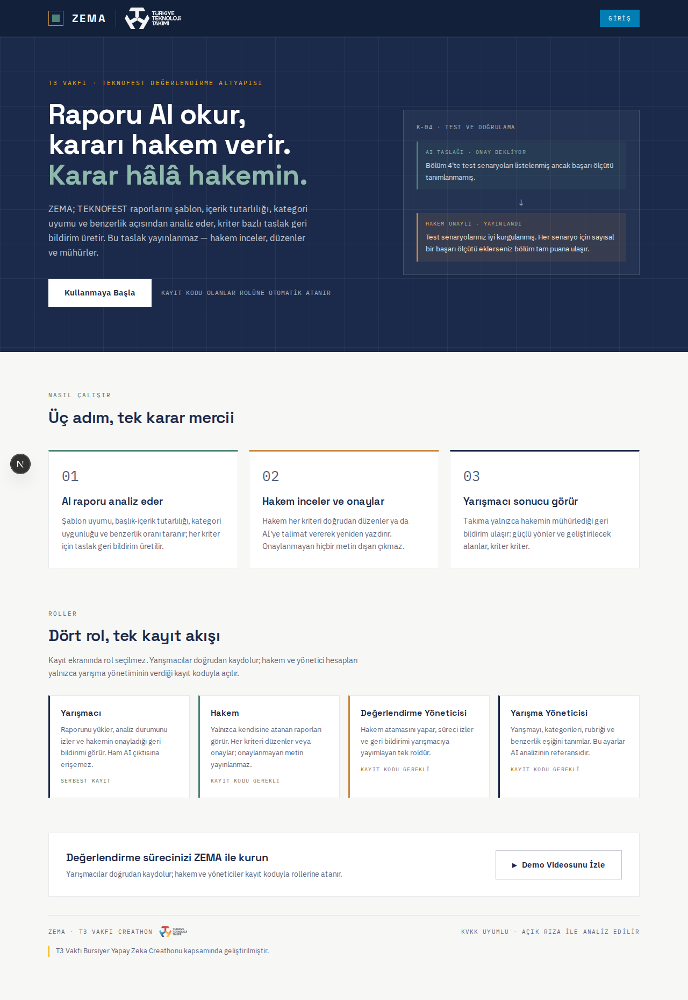
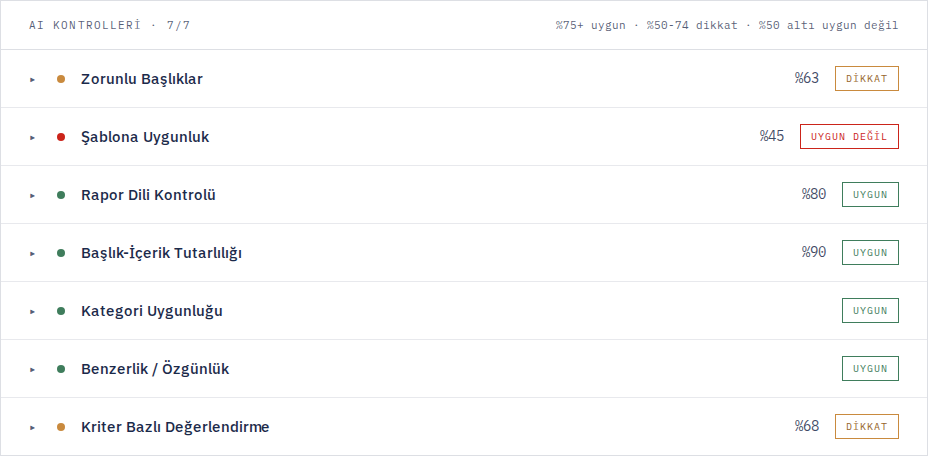
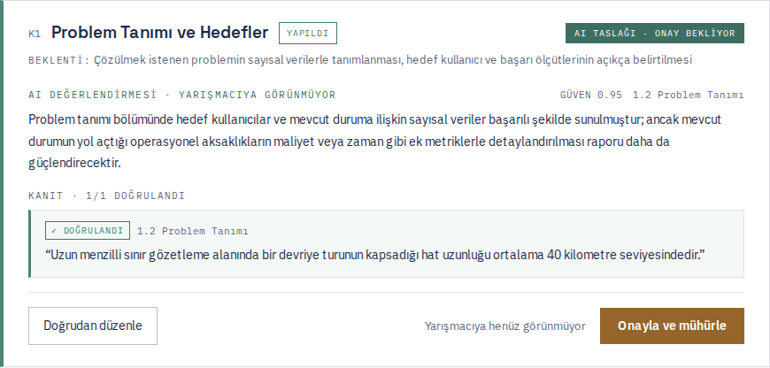
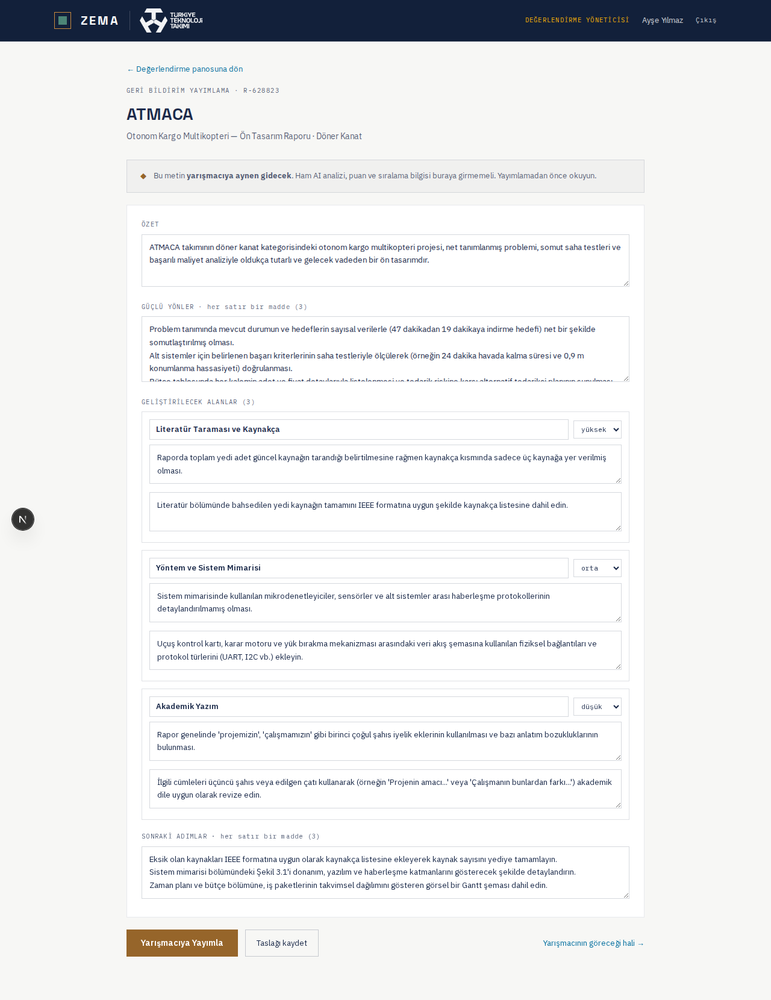
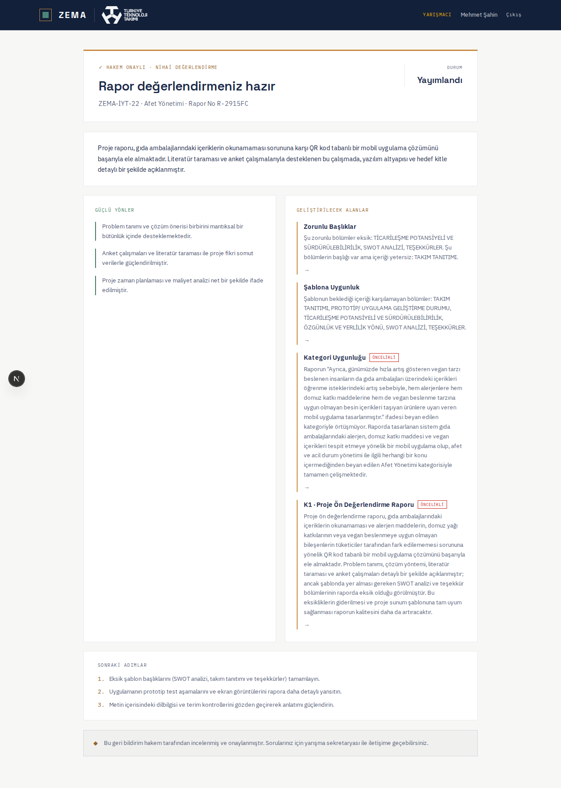
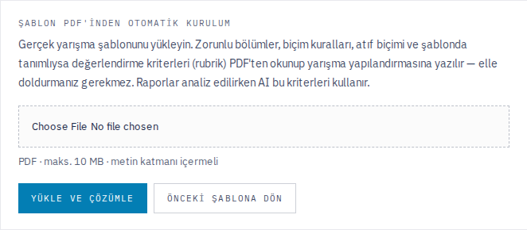

# ZEMA

**TEKNOFEST raporlarını değerlendiren hakemlere yardım eden yapay zekâ sistemi.**
T3 Vakfı Bursiyer Yapay Zekâ Creathonu — Problem 4.

> **AI karar vermez, hakemi hızlandırır.**
> Her AI çıktısı bir *öneri*dir. Hakem onaylar, düzenler veya reddeder.
> Onaylanmayan hiçbir metin yarışmacıya ulaşmaz.



## Canlı Demo (salt okunur)

**https://zema-ai.vercel.app**

Giriş ekranındaki **Profil seç** bölümünden dört rolden birini seçin:
Yarışmacı, Hakem, Değerlendirme Yöneticisi veya Yarışma Yöneticisi. Şifre
gerekmez, tek tıkla girilir ve o rolün bütün ekranları gezilebilir.

Site bir portfolyo vitrini olarak **salt okunur** çalışıyor: yükleme, onay,
yayımlama gibi hiçbir işlem kaydedilmez, yeni kayıt kapalıdır. Ekranlardaki
yarışmacı, hakem, takım ve rapor verileri **sahtedir**.

## Problem ve çözüm

TEKNOFEST'te her yıl binlerce takım rapor gönderiyor ve her raporun şablona
uyup uymadığı, kriterleri karşılayıp karşılamadığı, başka raporlara ne kadar
benzediği hakemler tarafından elle kontrol ediliyor. Bu iş yavaş, ve
takımlara giden geri bildirim çoğu zaman kısa kalıyor.

ZEMA bu ön incelemeyi yapay zekâya yaptırıyor, kararı ise hakemde bırakıyor:

1. **Yarışmacı raporunu (PDF) yükler.** Sistem raporu otomatik olarak sekiz
   açıdan inceler.
2. **Hakem AI'nin önerilerini görür.** Her kriteri onaylar ya da kendi
   cümleleriyle düzeltir. AI'nin gösterdiği her kanıt, rapordan birebir
   alıntıdır.
3. **Değerlendirme Yöneticisi geri bildirimi yayımlar.** Yarışmacı yalnızca
   hakemin onayladığı, yapıcı geri bildirimi görür; ham AI çıktısını asla
   görmez.

## Roller

| Rol | Ne yapar |
|---|---|
| **Yarışmacı** | Rapor yükler, durumu izler, yayımlanan geri bildirimi okur |
| **Hakem** | Kendisine atanan raporları inceler, AI önerilerini onaylar veya düzeltir |
| **Değerlendirme Yöneticisi** | Raporları hakemlere atar, süreci izler, geri bildirimi yayımlar |
| **Yarışma Yöneticisi** | Yarışmayı, kategorileri, rapor şablonunu ve değerlendirme kriterlerini tanımlar |

Hakem ekranında sekiz kontrolün sonucu tek bir listede görünür, her biri
açılıp ayrıntısı okunabilir. Renkler sabittir: yeşil uygun, turuncu dikkat,
kırmızı uygun değil.



Her değerlendirme kriteri için AI'nin gerekçesi ve rapordan alıntılanan
kanıtlar ayrı bir kartta gösterilir; hakem metni düzenleyip mühürler.



Değerlendirme Yöneticisi, hakem onaylı metinlerden otomatik derlenen geri
bildirimi son kez düzenleyip yarışmacıya yayımlar.



Yarışmacının gördüğü: güçlü yönler, geliştirilecek alanlar ve sonraki adımlar.



Yarışma Yöneticisi, yarışmanın şablon ve şartname PDF'lerini yükler; AI
bunlardan zorunlu bölümleri ve değerlendirme kriterlerini çıkarır.



## Sekiz AI kontrolü

| Kontrol | Ne bakıyor |
|---|---|
| **Zorunlu Başlıklar** | Şablonun istediği bölümler raporda var mı |
| **Şablona Uygunluk** | Bölümlerin içeriği ve biçim kuralları (yazı tipi, sayfa sınırı vb.) |
| **Rapor Dili** | Yazım ve anlatım hataları, sayfa numarasıyla |
| **Başlık-İçerik Tutarlılığı** | Başlığın vaat ettiğiyle içerik örtüşüyor mu |
| **Kategori Uygunluğu** | Seçilen kategori rapora uyuyor mu |
| **Benzerlik / Özgünlük** | Diğer raporlarla metin benzerliği |
| **Kriter Bazlı Değerlendirme** | Her kriter için kanıtlı değerlendirme |
| **AI Değerlendirme Özeti** | Hepsinin yarışmacıya gidecek tek bir taslakta toplanması |

### Uydurmaya karşı önlem

AI'nin kanıt olarak verdiği her alıntı, rapor metninde birebir aranır.
Bulunamayan alıntı kırmızı rozetle işaretlenir ve o değerlendirmenin güven
skoru düşürülür. Canlı veride 77 alıntının 76'sı birebir doğrulandı;
doğrulanamayan tek alıntı sessizce geçmedi, işaretlendi.

## Teknik altyapı

**Next.js 16** · **Supabase** (Postgres, Auth, Storage) · **Google Gemini API** · **Vercel** · Tailwind CSS

- **Analiz kuyruğu:** Sekiz kontrol tek seferde çalıştırılmaz. Her kontrol
  kuyrukta ayrı bir iş olur ve sırayla işlenir. Böylece sunucu süre sınırına
  takılmaz, hakem de biten kontrolleri beklemeden görmeye başlar.
- **Kota yönetimi:** Ücretsiz Gemini kotası sınırlı olduğu için birden fazla
  API anahtarı ve model sırayla denenir; biri dolunca sıradakine geçilir.
- **Güvenlik:** Kim neyi görebilir kuralı veritabanında (Postgres RLS)
  uygulanır. Yarışmacı ham AI çıktısını, hakem kendisine atanmamış raporu
  sorgu seviyesinde bile göremez. Hakem ve yönetici hesapları yalnızca kayıt
  koduyla açılır.

## Yerelde çalıştırma

```bash
npm install
cp .env.example .env.local      # Supabase ve Gemini anahtarlarını doldur
```

Supabase SQL Editor'de `supabase/migrations/` klasöründeki dosyaları numara
sırasıyla çalıştırın (`0012` ve `0013` iki ayrı çalıştırma olmalı).
`0018_read_only.sql` yalnızca salt okunur vitrin için, isteğe bağlı.

```bash
npm run seed      # örnek yarışma, kriterler ve 4 rol için test hesabı
npm run dev
```

Önemli ortam değişkenleri (tam liste `.env.example`'da):

| Değişken | Ne işe yarar |
|---|---|
| `NEXT_PUBLIC_SUPABASE_URL`, `NEXT_PUBLIC_SUPABASE_ANON_KEY` | Supabase bağlantısı |
| `SUPABASE_SERVICE_ROLE_KEY` | Sunucu tarafı yönetici erişimi — asla istemciye verilmez |
| `GOOGLE_API_KEY` (+ `_1`…`_10`) | Gemini API anahtar(lar)ı |
| `MOCK_AI` | `true` iken gerçek AI çağrılmaz, sabit örnek cevap döner (varsayılan) |
| `REGISTRATION_CODE_*` | Hakem/yönetici kayıt kodları |
| `READ_ONLY` | `true` iken site salt okunur vitrine döner |

Hakem veya yönetici hesabı gerekiyorsa proje sahibinden kayıt kodu isteyin.

## Sınırlar ve sonraki adım

- Taranmış (metin katmanı olmayan) PDF'ler desteklenmiyor.
- KVKK aydınlatma metni taslak; hukuki onaydan geçmedi.
- Gelecek sürümde, hakem düzeltmeleriyle bir dil modelinin ince ayarla
  (fine-tuning) eğitilmesi planlanıyor.

Ayrıntılı geliştirme notları: [`docs/NOTES.md`](docs/NOTES.md) ·
Mimari kararlar: [`docs/PLAN.md`](docs/PLAN.md)
